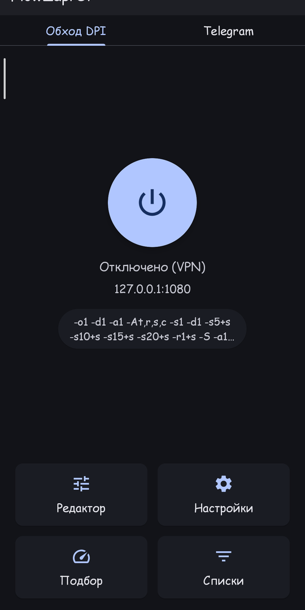
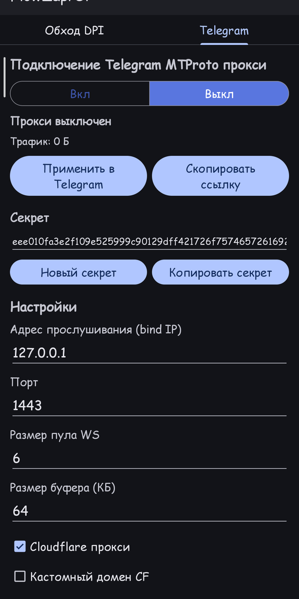
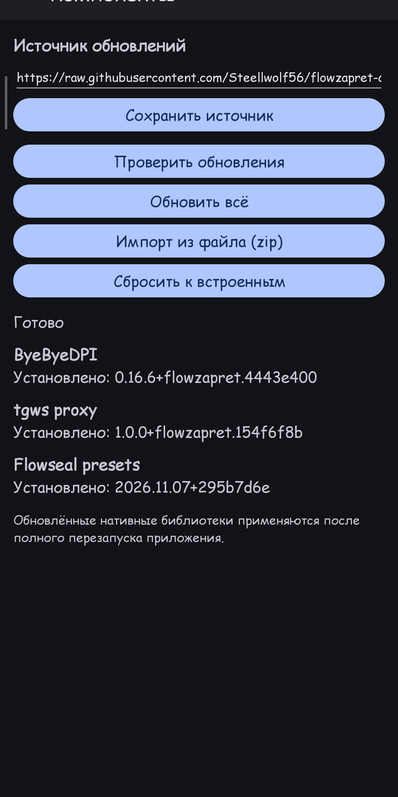
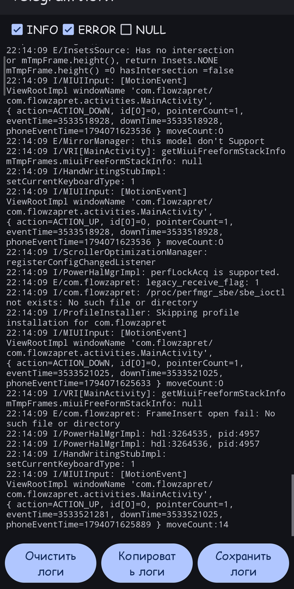

<div align="center">


# FlowZapret

**DPI bypass and a Telegram MTProto proxy in a single app.**

A fork of [ByeByeDPI](https://github.com/romanvht/ByeDPIAndroid) with
[Flowseal](https://github.com/Flowseal/zapret-discord-youtube) strategies and a
built-in Telegram proxy tab powered by the Rust [tg-ws-proxy](https://github.com/Flowseal/tg-ws-proxy) core.

[](https://github.com/Steellwolf56/flowzapret/releases/latest)
[](https://github.com/Steellwolf56/flowzapret/releases)
[](LICENSE)
-3DDC84?logo=android&logoColor=white)


[Русский](README.md) | English

</div>

---

## Features

| | |
| --- | --- |
| 🛡️ **DPI bypass** | VPN mode (hev-socks5-tunnel) and local SOCKS proxy, 22 Flowseal strategies, strategy auto-detection, domain lists, quick tiles and shortcuts. |
| ✈️ **Telegram MTProto** | Built-in proxy on the Rust tg-ws-proxy core: DC auto/manual, DC1–DC5, media DC, Fake TLS, custom CF domain, test DC, `no-secure`, PROXY protocol, pool and buffer. |
| 🔄 **Independence** | The “DPI bypass” and “Telegram” tabs run simultaneously without interfering with each other. |
| ⬆️ **Updates without rebuilding** | The ByeByeDPI core, the tgws proxy core and the Flowseal presets update in-app (signed manifest, SHA-256 and ABI checks). |
| 📋 **Logs** | Proxy log viewer with INFO/ERROR/NULL filters, copy and save to file. |

## Screenshots

<div align="center">
  
  
  
  
</div>

## Install

1. Download an APK from the [**Releases**](https://github.com/Steellwolf56/flowzapret/releases/latest) page:

   | File | Purpose |
   | --- | --- |
   | `FlowZapret-<version>-universal.apk` | works on any device (all ABIs inside) |
   | `FlowZapret-<version>-arm64-v8a.apk` | modern 64-bit ARM devices only |
   | `FlowZapret-<version>-armeabi-v7a.apk` | older 32-bit ARM devices only |

2. Allow installation from unknown sources and open the file.
3. Optionally verify the checksum from `SHA256SUMS-<version>`.

> Android 8.0 (API 26) or newer. **ARM only** (`armeabi-v7a`, `arm64-v8a`);
> x86/x86_64 are not supported.

## Updatable components

The app can update its internals without rebuilding the APK: **menu → Components**.

- ByeByeDPI — `libbyedpi.so`
- Telegram proxy — `libtgwsproxy.so`
- Flowseal presets — `flowseal_presets.json`

The update manifest is signed with **ECDSA P-256**, every artifact is verified by
**SHA-256**, and native libraries additionally by ELF header and ABI. Installation
is atomic, with fallback to the bundled version on error.

Default source:
`https://raw.githubusercontent.com/Steellwolf56/flowzapret-components/main/components.json`

See [docs/COMPONENTS.md](docs/COMPONENTS.md) for the manifest format, signing and publishing.

## Flowseal presets

All 22 strategies in their original order — General, ALT, ALT 2…ALT 13, EXP,
Fake TLS AUTO (+ALT 1–3), Simple Fake (+ALT 1–2). They are added to the command
history as pinned named presets and are used by strategy auto-detection.

See [docs/flowseal-mapping.md](docs/flowseal-mapping.md) for the ByeDPI argument
mapping and known incompatibilities.

## Building

Requires the Android SDK, NDK and Rust targets for ARM.

```bash
# 1) APK (ABI: armeabi-v7a, arm64-v8a)
./gradlew :app:assembleRelease
# output: app/build/outputs/apk/release/

# 2) Updatable components + signature (dist/components, zip)
tools/generate-signing-key.sh   # once: manifest signing key
tools/build-components.sh

# 3) Publish components
tools/publish-components.sh

# 4) APKs into dist/ and a GitHub release (requires gh)
tools/publish-app.sh
```

The proxy Rust core lives in `third_party/tgwsproxy/` (GPL-3.0); built libraries
are in `app/src/main/tgwsJniLibs/`.

## Documentation

- [docs/COMPONENTS.md](docs/COMPONENTS.md) — components, manifest, signing, publishing, rollback
- [docs/flowseal-mapping.md](docs/flowseal-mapping.md) — Flowseal presets → ByeDPI arguments
- [CHANGELOG.md](CHANGELOG.md) — version history
- [README-RU.md](README-RU.md) — detailed Russian description

## Credits

- [ByeByeDPI](https://github.com/romanvht/ByeDPIAndroid) and [ByeDPI](https://github.com/hufrea/byedpi) — DPI bypass foundation
- [Flowseal / zapret-discord-youtube](https://github.com/Flowseal/zapret-discord-youtube) — presets and domain lists
- [Flowseal / tg-ws-proxy](https://github.com/Flowseal/tg-ws-proxy) and [amurcanov / tg-ws-proxy-android](https://github.com/amurcanov/tg-ws-proxy-android) — Telegram proxy
- [bol-van / zapret](https://github.com/bol-van/zapret), [heiher / hev-socks5-tunnel](https://github.com/heiher/hev-socks5-tunnel), [JNA](https://github.com/java-native-access/jna)

## License

[GPL-3.0](LICENSE). When distributing derivative works, keep the license terms
and credit the sources (ByeByeDPI, ByeDPI, Flowseal, amurcanov, bol-van).
