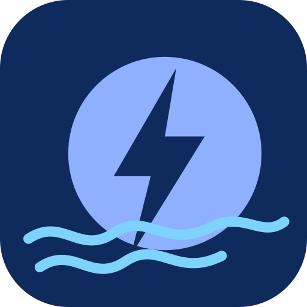

<div align="center">



# FlowZapret

**DPI engellemelerini aşma ve Telegram MTProto proxy — tek uygulamada.**

[ByeByeDPI](https://github.com/romanvht/ByeDPIAndroid) temelli, [Flowseal](https://github.com/Flowseal/zapret-discord-youtube)
stratejileri ve Rust çekirdeği [tg-ws-proxy](https://github.com/Flowseal/tg-ws-proxy)
üzerinde çalışan yerleşik Telegram proxy sekmesi içeren bir çatallama (fork).

[](https://github.com/Steellwolf56/flowzapret/releases/latest)
[](https://github.com/Steellwolf56/flowzapret/releases)
[](LICENSE)
-3DDC84?logo=android&logoColor=white)


[Русский](README.md) | [English](README-en.md) | Türkçe

</div>

---

## Özellikler

| | |
| --- | --- |
| 🛡️ **DPI aşma** | VPN modu (hev-socks5-tunnel) ve yerel SOCKS proxy, 22 Flowseal stratejisi, otomatik strateji seçimi, alan adı listeleri, hızlı kutucuklar ve kısayollar. |
| ✈️ **Telegram MTProto** | Rust tg-ws-proxy çekirdeği üzerinde yerleşik proxy: DC auto/manual, DC1–DC5, media DC, Fake TLS, özel CF alan adı, test DC, `no-secure`, PROXY protokolü, havuz ve tampon. |
| 🔄 **Bağımsızlık** | “Обход DPI” ve “Telegram” sekmeleri aynı anda, birbirini etkilemeden çalışır. |
| ⬆️ **APK’sız güncelleme** | ByeByeDPI çekirdeği, tgws proxy çekirdeği ve Flowseal presetleri uygulama içinden güncellenir (imzalı manifest, SHA-256 ve ABI kontrolü). |
| 📋 **Günlükler** | INFO/ERROR/NULL filtreli proxy günlük görüntüleyici; kopyalama ve dosyaya kaydetme. |

## Kurulum

1. [**Releases**](https://github.com/Steellwolf56/flowzapret/releases/latest) sayfasından bir APK indirin:

   | Dosya | Amaç |
   | --- | --- |
   | `FlowZapret-<sürüm>-universal.apk` | her cihaz için (tüm ABI’lar dahil) |
   | `FlowZapret-<sürüm>-arm64-v8a.apk` | yalnızca modern 64 bit ARM cihazlar |
   | `FlowZapret-<sürüm>-armeabi-v7a.apk` | yalnızca eski 32 bit ARM cihazlar |

2. Bilinmeyen kaynaklardan kuruluma izin verin ve dosyayı açın.
3. İsterseniz `SHA256SUMS-<sürüm>` ile sağlama toplamını doğrulayın.

> Android 8.0 (API 26) ve üzeri gerekir. Yalnızca **ARM** desteklenir
> (`armeabi-v7a`, `arm64-v8a`); x86/x86_64 desteklenmez.

## Güncellenebilir bileşenler

Uygulama içeriğini APK’yı yeniden derlemeden güncelleyebilir: **menü → Компоненты**.

- ByeByeDPI — `libbyedpi.so`
- Telegram proxy — `libtgwsproxy.so`
- Flowseal presetleri — `flowseal_presets.json`

Güncelleme manifesti **ECDSA P-256** ile imzalanır, her dosya **SHA-256** ile,
yerel kütüphaneler ayrıca ELF başlığı ve ABI ile doğrulanır. Kurulum atomiktir;
hata durumunda paket içindeki sürüme geri dönülür.

Varsayılan kaynak:
`https://raw.githubusercontent.com/Steellwolf56/flowzapret-components/main/components.json`

Ayrıntılar: [docs/COMPONENTS.md](docs/COMPONENTS.md).

## Derleme

Android SDK, NDK ve ARM için Rust hedefleri gerekir.

```bash
./gradlew :app:assembleRelease          # APK
tools/build-components.sh               # bileşenler + imza
tools/publish-components.sh             # bileşenleri yayınla
```

Rust proxy çekirdeği `third_party/tgwsproxy/` (GPL-3.0) altındadır; derlenen
kütüphaneler `app/src/main/tgwsJniLibs/` içindedir.

## Belgeler

- [docs/COMPONENTS.md](docs/COMPONENTS.md) — bileşenler, manifest, imza, yayınlama
- [docs/flowseal-mapping.md](docs/flowseal-mapping.md) — Flowseal presetleri → ByeDPI argümanları
- [CHANGELOG.md](CHANGELOG.md) — sürüm geçmişi

## Teşekkürler

- [ByeByeDPI](https://github.com/romanvht/ByeDPIAndroid) ve [ByeDPI](https://github.com/hufrea/byedpi)
- [Flowseal / zapret-discord-youtube](https://github.com/Flowseal/zapret-discord-youtube)
- [Flowseal / tg-ws-proxy](https://github.com/Flowseal/tg-ws-proxy) ve [amurcanov / tg-ws-proxy-android](https://github.com/amurcanov/tg-ws-proxy-android)
- [bol-van / zapret](https://github.com/bol-van/zapret), [heiher / hev-socks5-tunnel](https://github.com/heiher/hev-socks5-tunnel), [JNA](https://github.com/java-native-access/jna)

## Lisans

[GPL-3.0](LICENSE). Türev çalışmaları dağıtırken lisans koşullarını koruyun ve
kaynakları belirtin (ByeByeDPI, ByeDPI, Flowseal, amurcanov, bol-van).
