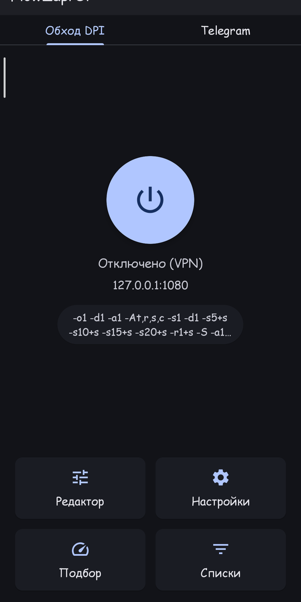
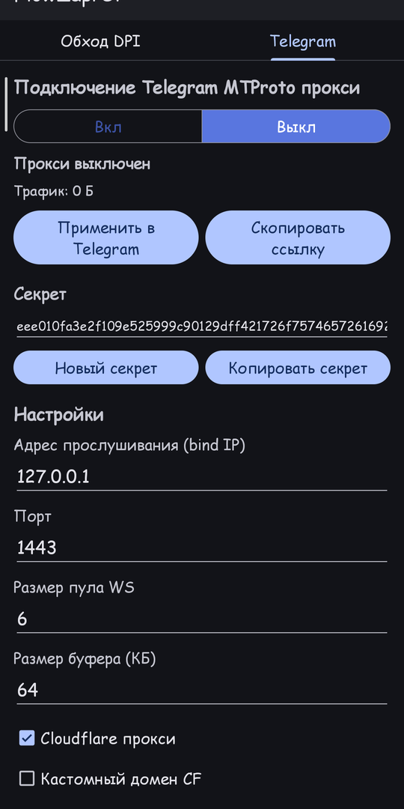
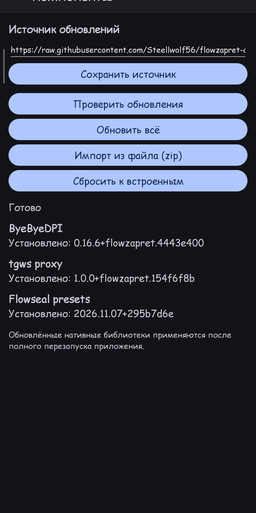
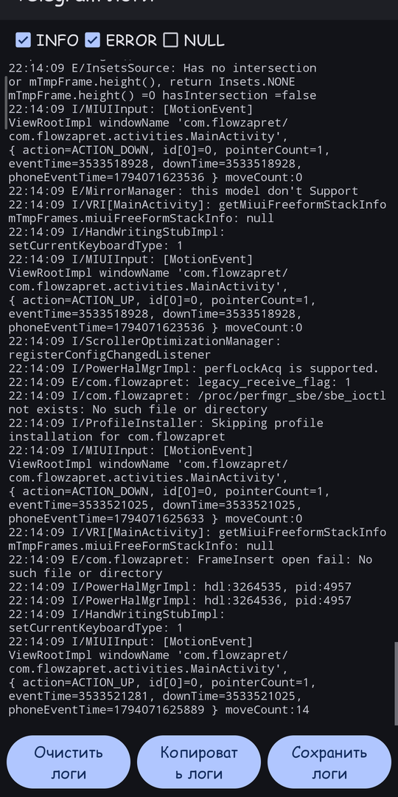

<div align="center">


# FlowZapret

**Обход DPI-блокировок и Telegram MTProto-прокси в одном приложении.**

Форк [ByeByeDPI](https://github.com/romanvht/ByeDPIAndroid) со стратегиями
[Flowseal](https://github.com/Flowseal/zapret-discord-youtube) и встроенной
вкладкой Telegram-прокси на Rust-ядре [tg-ws-proxy](https://github.com/Flowseal/tg-ws-proxy).

[](https://github.com/Steellwolf56/flowzapret/releases/latest)
[](https://github.com/Steellwolf56/flowzapret/releases)
[](LICENSE)
-3DDC84?logo=android&logoColor=white)


[Русский](README.md) | [English](README-en.md)

</div>

---

## Возможности

| | |
| --- | --- |
| 🛡️ **Обход DPI** | VPN-режим (hev-socks5-tunnel) и локальный SOCKS-прокси, 22 стратегии Flowseal, автоподбор, доменные списки, быстрые плитки и ярлыки. |
| ✈️ **Telegram MTProto** | Собственный прокси на Rust-ядре tg-ws-proxy: DC auto/manual, DC1–DC5, media-DC, Fake TLS, custom CF-домен, тест DC, `no-secure`, PROXY-протокол, пул и буфер. |
| 🔄 **Независимость** | Вкладки «Обход DPI» и «Telegram» работают одновременно и не мешают друг другу. |
| ⬆️ **Обновления без APK** | Ядро ByeByeDPI, ядро tgws-прокси и пресеты Flowseal обновляются прямо из приложения (подписанный манифест, SHA-256 и проверка ABI). |
| 📋 **Логи** | Просмотр логов прокси с фильтрами INFO/ERROR/NULL, копированием и сохранением в файл. |

## Скриншоты

<div align="center">
  
  
  
  
</div>

## Установка

1. Скачай APK со страницы [**Releases**](https://github.com/Steellwolf56/flowzapret/releases/latest):

   | Файл | Для чего |
   | --- | --- |
   | `FlowZapret-<версия>-universal.apk` | подходит для любого устройства (архитектуры внутри) |
   | `FlowZapret-<версия>-arm64-v8a.apk` | только для современных 64-битных ARM-устройств |
   | `FlowZapret-<версия>-armeabi-v7a.apk` | только для старых 32-битных ARM-устройств |

2. Разреши установку из неизвестных источников и открой файл.
3. Проверь контрольную сумму из `SHA256SUMS-<версия>` при желании.

> Требуется Android 8.0 (API 26) и выше. Поддерживаются **только ARM-устройства**
> (`armeabi-v7a`, `arm64-v8a`); x86/x86_64 не поддерживаются.

## Обновляемые компоненты

Приложение умеет обновлять «начинку» без пересборки APK: **меню → Компоненты**.

- ByeByeDPI — `libbyedpi.so`
- Telegram-прокси — `libtgwsproxy.so`
- Пресеты Flowseal — `flowseal_presets.json`

Манифест обновлений подписан **ECDSA P-256**, каждый артефакт проверяется по
**SHA-256**, нативные библиотеки — по ELF-заголовку и ABI. Установка атомарная,
при ошибке — откат к встроенной версии.

Источник по умолчанию:
`https://raw.githubusercontent.com/Steellwolf56/flowzapret-components/main/components.json`

Полное описание формата, подписи и публикации — в
[docs/COMPONENTS.md](docs/COMPONENTS.md).

## Пресеты Flowseal

Все 22 стратегии в исходном порядке — General, ALT, ALT 2…ALT 13, EXP,
Fake TLS AUTO (+ALT 1–3), Simple Fake (+ALT 1–2). Они добавляются в историю
команд как закреплённые именованные пресеты и участвуют в автоподборе.

Соответствие аргументов ByeDPI и список несовместимостей —
в [docs/flowseal-mapping.md](docs/flowseal-mapping.md).

## Сборка

Нужны Android SDK, NDK и Rust-таргеты для ARM.

```bash
# 1) APK (ABI: armeabi-v7a, arm64-v8a)
./gradlew :app:assembleRelease
# результат: app/build/outputs/apk/release/

# 2) Обновляемые компоненты + подпись (dist/components, zip)
tools/generate-signing-key.sh   # один раз: ключ подписи манифеста
tools/build-components.sh

# 3) Публикация компонентов
tools/publish-components.sh

# 4) APK в dist/ + GitHub-релиз (нужен gh)
tools/publish-app.sh
```

Rust-ядро прокси лежит в `third_party/tgwsproxy/` (GPL-3.0); собранные
библиотеки — в `app/src/main/tgwsJniLibs/`.

## Документация

- [docs/COMPONENTS.md](docs/COMPONENTS.md) — компоненты, манифест, подпись, публикация, откат
- [docs/flowseal-mapping.md](docs/flowseal-mapping.md) — пресеты Flowseal → аргументы ByeDPI
- [CHANGELOG.md](CHANGELOG.md) — история версий
- [README-RU.md](README-RU.md) — подробное описание на русском

## Благодарности

- [ByeByeDPI](https://github.com/romanvht/ByeDPIAndroid) и [ByeDPI](https://github.com/hufrea/byedpi) — основа обхода DPI
- [Flowseal / zapret-discord-youtube](https://github.com/Flowseal/zapret-discord-youtube) — пресеты и доменные списки
- [Flowseal / tg-ws-proxy](https://github.com/Flowseal/tg-ws-proxy) и [amurcanov / tg-ws-proxy-android](https://github.com/amurcanov/tg-ws-proxy-android) — Telegram-прокси
- [bol-van / zapret](https://github.com/bol-van/zapret), [heiher / hev-socks5-tunnel](https://github.com/heiher/hev-socks5-tunnel), [JNA](https://github.com/java-native-access/jna)

## Лицензия

[GPL-3.0](LICENSE). При распространении производных работ сохраняйте требования
лицензии и указывайте источники (ByeByeDPI, ByeDPI, Flowseal, amurcanov, bol-van).
